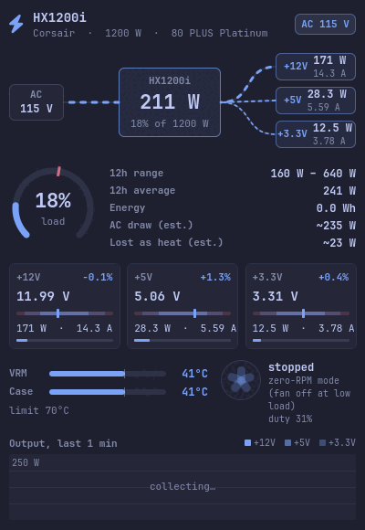
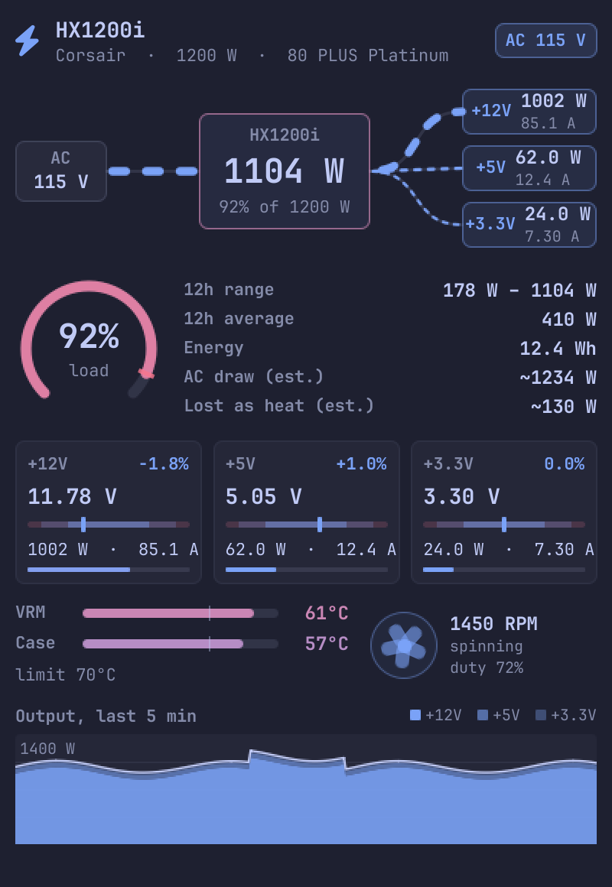
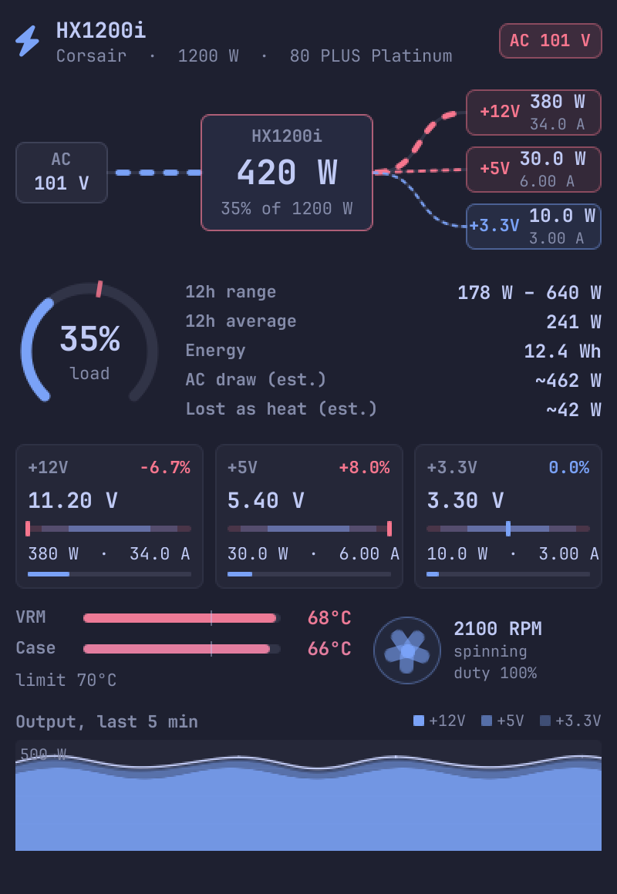

# Corsair Plimsoll

**A Corsair PSU monitor for Omarchy**: a bar widget and animated panel for Corsair i-series power supplies.

It shows what the supply itself reports: total and per-rail power, voltage regulation, current, temperatures, fan,
and a 12 hour history. Nothing is installed beyond the plugin, and nothing needs root.

*The name:* a corsair is a privateer, and the Plimsoll line is the mark on a ship's hull that shows how heavily it
may be loaded. This is a load gauge for your supply.

> Unofficial. This is an independent project and is not affiliated with, endorsed by or sponsored by Corsair.
> "Corsair" is a trademark of its owner and is used here only to say which hardware the plugin reads.

<p align="center">
  
</p>

> The animation and the images in this README are renders of the panel's own view, not screenshots of a
> running desktop. The load in the animation is a simulated gaming session (idle, a ramp to about 900 W with
> jitter, a dip, a spike past 1000 W, then back to idle), and the other values are realistic for an HX1200i. The
> history traces are made up. The panel animates the same way on live readings.

| Heavy load | A rail out of spec |
|---|---|
|  |  |

## What it shows

**Measured** (read straight from the supply):

- Total output power, and each rail's power, voltage and current (+12 V, +5 V, +3.3 V)
- How far each rail sits from nominal against the ATX ±5% band (comfortable inside ±3%)
- The supply's own protection limits (under-voltage, over-voltage, over-current) in each rail's tooltip
- VRM and case temperature against the supply's limit
- Mains voltage
- Fan speed and commanded duty. A stopped fan at low load is the supply's zero-RPM mode, not a fault
- A rolling history: the last five minutes per rail, plus the lowest, highest and average output over the last
  12 hours (kept across restarts)
- Energy delivered since the shell started

**Animated** (only while the panel is open): dashes flow along the power-flow lines, faster with more current and
thicker with more power; the load gauge eases to its value; the fan rotor spins and stops with the real fan.

**Estimated, and always labelled "est."**

- AC draw and the heat lost converting it. These supplies do not report wall power, so the widget estimates it
  from the unit's 80 PLUS tier (see the `efficiencyRating` setting). It uses the certification *minimum*
  efficiency at 115 V, so the real figure is a little better. Set the rating to `none` to hide the estimate.

Nothing is invented where the supply is silent. There is no AC input current, so wall power and true efficiency
are never shown as measurements, and the rails are not summed against the total (the readings are taken a few
milliseconds apart, so they would not add up exactly).

## Requirements and dependencies

The plugin installs nothing. It needs these to be present already:

- Omarchy with the shell plugin system (`omarchy plugin` commands)
- A Corsair "i" series supply that the `corsair-psu` kernel driver supports (the HXi and RMi lines; see the
  kernel's `corsair-psu` documentation for the exact list), connected with its USB cable to a motherboard header
- The `corsair-psu` kernel driver (in the mainline kernel since 5.10). It appears as an hwmon device named
  `corsairpsu`. Check with `sensors | grep -A3 corsairpsu`
- Python 3 (standard library only; nothing to `pip` install)
- `lm_sensors` is optional and only needed for the `sensors` check above; the plugin itself reads sysfs directly

**Tested on:** a Corsair HX1200i on Arch / Omarchy, kernel 7.2. Other models the same driver supports should work,
but I have not tested them. If yours does not, or shows odd values, please open an issue with the
output of `sensors` for the supply.

## Install

```sh
omarchy plugin add https://github.com/tastyhub/omarchy-corsair-plimsoll.git --enable
```

Or, if you add it by hand, enable it on the bar:

```sh
omarchy plugin enable io.github.tastyhub.corsair-plimsoll --section center
```

Click the bolt to open the panel.

## Remove

```sh
omarchy plugin remove io.github.tastyhub.corsair-plimsoll
```

That takes the widget off the bar and deletes the plugin. The only thing it leaves behind is the 12 hour history
file, which you can delete if you do not want it:

```sh
rm -r ~/.local/state/omarchy-psu
```

## What it touches

- **Reads** the supply's hwmon files under `/sys/class/hwmon/`. Read-only; no root, and no privileged commands
  in the plugin itself. (Only loading the kernel driver, if it is not already loaded, needs root, and you do that
  yourself outside the plugin.)
- **Runs** one helper, `psu-read.py` (Python 3, in the plugin directory), and creates the state folder below with
  `mkdir -p`.
- **Writes** only `~/.local/state/omarchy-psu/history.json` (a few hundred bytes of 10 minute power buckets).
- **Does not** change your Omarchy or shell configuration. Putting the widget on the bar is something you do with
  `omarchy plugin enable`; the plugin never edits your settings itself.
- **Does not** use the network, install packages, or run anything downloaded.

## Settings

| Setting | Default | |
|---|---|---|
| `showWatts` | on | Show the wattage beside the bolt |
| `hideWhenAbsent` | on | Hide the widget when no supply is detected |
| `pollIntervalSec` | 5 | How often the bar reads total power (2 to 60) |
| `efficiencyRating` | platinum | Your unit's 80 PLUS tier, for the wall-power estimate: platinum, titanium, gold, silver, bronze, or none |

**Set `efficiencyRating` to the tier printed on your supply.** The default is Platinum because that is what the
unit this was written on is.

IPC: `omarchy-shell ipc call psu toggle` (also `open` and `close`).

## How it works

Every reading from the supply is a USB transaction taking about 3 ms, so a full read of all its sensors takes
around 45 ms. Done on the shell's UI thread that would stutter the animations, so `psu-read.py` does the reading
in its own process and prints one JSON object per line. The shell only parses those lines.

There are two readers:

- **slow** (always on): total power, each rail's power and the temperatures every few seconds, for the bar, the
  12 hour history and the chart, so the chart already has history when you open the panel
- **fast** (only while the panel is open): every rail's voltage and current, and the fan, once a second. The chart
  draws one point per second, so the gaps between slow readings are filled with straight lines.

Everything the helper prints is parsed as untrusted data in `Model.js`: known keys only, numbers clamped to a
plausible range. The 12 hour history is saved to `~/.local/state/omarchy-psu/history.json`, outside the plugin
directory, because the shell reloads a plugin whenever a file inside it changes.

| File | Role |
|---|---|
| `manifest.json` | plugin declaration and settings |
| `BarWidget.qml` | the bar readout; owns the data; loads the panel |
| `Panel.qml` | the popout, hosting the view |
| `PsuView.qml` | everything visual, with no hardware access |
| `PsuData.qml` | helper processes, parsing, history, persistence |
| `Model.js` | parsing and arithmetic, with no shell dependencies |
| `psu-read.py` | streams the supply's readings as JSON lines |
| `tests/` | `node tests/model.test.js` runs the model's tests |

## Troubleshooting

- **"not detected" or no widget:** run `sensors | grep -A3 corsairpsu`. If nothing appears, the driver is not
  loaded (load the `corsair-psu` module as root with `modprobe corsair-psu`) or the USB cable is not connected.
- **Readings update slowly:** that is the USB link; the supply answers each query in a few milliseconds.
- **Values look wrong for my model:** please open an issue with your `sensors` output.

## Limits

Fan control is not offered: the driver exposes the duty read-only. The supply's debugfs counters (uptime and the
like) need root and are left out. Temperatures are shown in Celsius.

## License

MIT. See [LICENSE](LICENSE).
